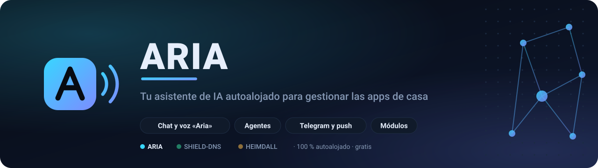
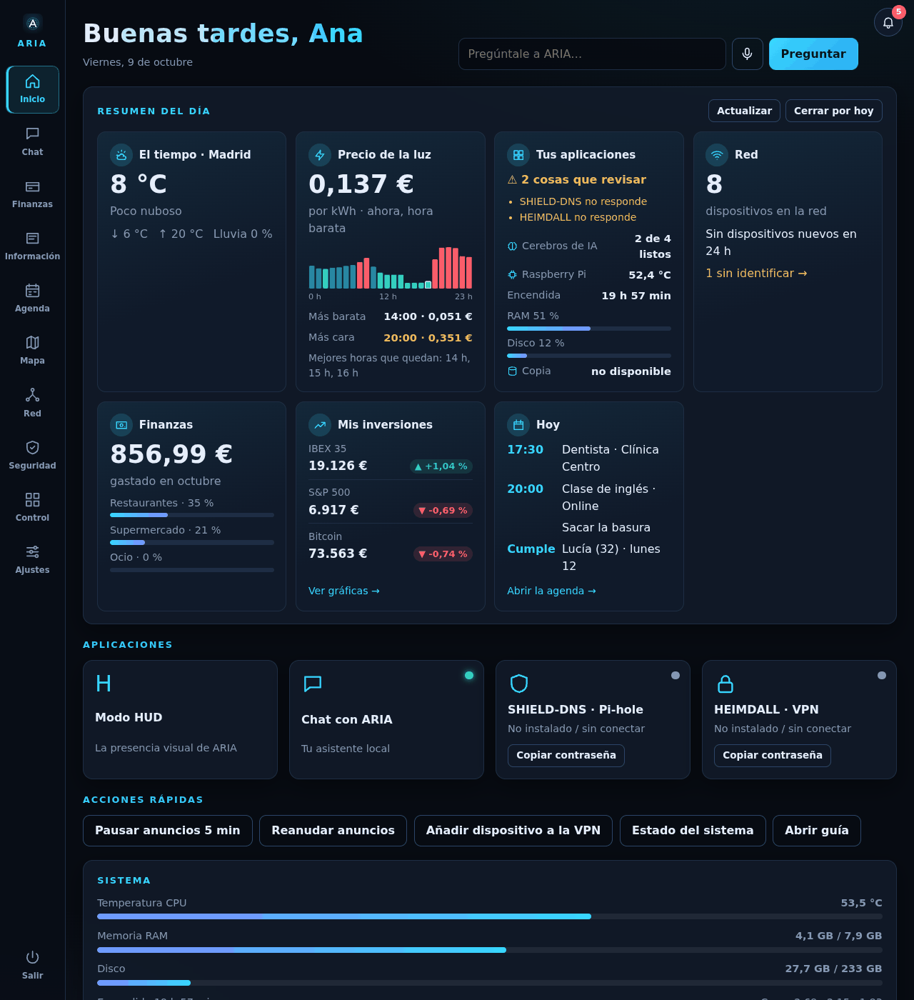
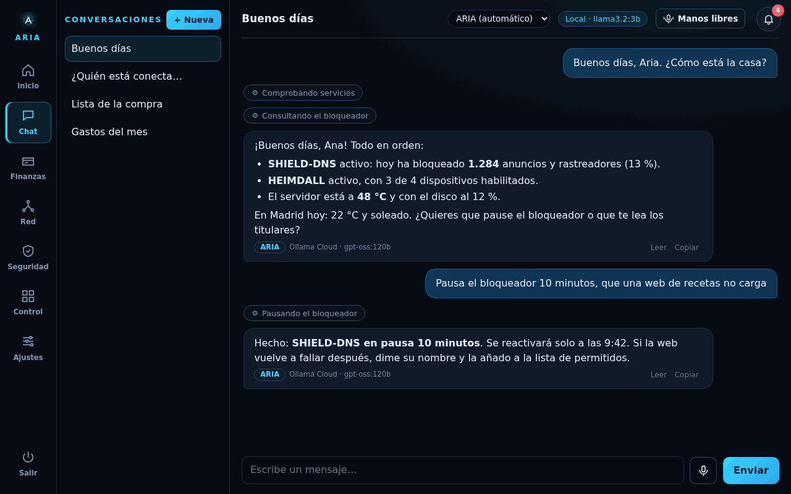
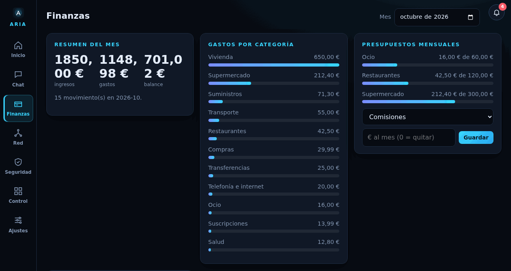
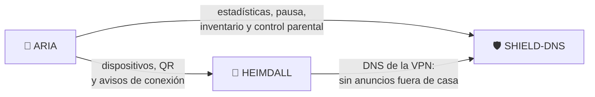

<a name="readme-top"></a>

<p align="center">
  <sub>Parte del ecosistema ARIA&nbsp;&nbsp;·&nbsp;&nbsp;<b>🤖 ARIA</b>&nbsp;&nbsp;·&nbsp;&nbsp;<a href="https://github.com/BertMarti/SHIELD-DNS">🛡️ SHIELD-DNS</a>&nbsp;&nbsp;·&nbsp;&nbsp;<a href="https://github.com/BertMarti/HEIMDALL">🔐 HEIMDALL</a></sub>
</p>

<p align="center">
  <picture>
    <source media="(prefers-color-scheme: dark)" srcset="docs/img/banner-oscuro.svg">
    <source media="(prefers-color-scheme: light)" srcset="docs/img/banner-claro.svg">
    
  </picture>
</p>

<p align="center">
  <a href="LICENSE"></a>
  
  
  
  
</p>

<p align="center">
  <b><a href="#-instalación-en-cuatro-pasos">🚀 Instalar</a></b>&nbsp;&nbsp;·&nbsp;&nbsp;
  <a href="docs/INSTALACION.md">📘 Instalación detallada</a>&nbsp;&nbsp;·&nbsp;&nbsp;
  <a href="docs/USO.md">🧭 Guía de uso</a>&nbsp;&nbsp;·&nbsp;&nbsp;
  <a href="docs/TECNICO.md">🛠️ Parte técnica</a>&nbsp;&nbsp;·&nbsp;&nbsp;
  <a href="https://bertmarti.github.io/ARIA/">🌐 Web</a>
</p>

**ARIA es el centro de control de una casa o familia en España: un asistente que vive en una Raspberry Pi o un PC con Linux, guarda tus datos en casa y te ayuda por texto, voz, móvil o Telegram.**

ARIA puede usar cerebros de IA en la nube para responder más rápido. Si los activas, tus mensajes y los datos necesarios para contestar salen de casa hacia ese proveedor. También puedes usar el cerebro local, con más privacidad y normalmente más lentitud.

<p align="center"></p>

<table>
  <tr>
    <td width="33%" valign="top"><h3>🏠 En tu casa</h3>Tus usuarios, conversaciones, documentos y ajustes se guardan en tu máquina.</td>
    <td width="33%" valign="top"><h3>🗣️ A tu manera</h3>Escribe, di «Aria», usa la app de Android, Telegram o recibe avisos.</td>
    <td width="33%" valign="top"><h3>👨‍👩‍👧 Para la familia</h3>Cada persona tiene sus datos y permisos. Las acciones delicadas piden confirmación.</td>
  </tr>
</table>

## 📑 Índice

- [✨ Qué puedes hacer](#-qué-puedes-hacer)
- [📸 Capturas](#-capturas)
- [🚀 Instalación en cuatro pasos](#-instalación-en-cuatro-pasos)
- [🔒 Privacidad y seguridad](#-privacidad-y-seguridad)
- [📱 Cómo entrar y recibir avisos](#-cómo-entrar-y-recibir-avisos)
- [🧩 Crecer con ARIA](#-crecer-con-aria)
- [📚 Guías](#-guías)
- [🌐 El ecosistema ARIA](#-el-ecosistema-aria)
- [💎 Licencia y ARIA Premium](#-licencia-y-aria-premium)

## ✨ Qué puedes hacer

| | Área | En palabras sencillas |
|:---:|---|---|
| 💬 | **Hablar con ARIA** | Chat con conversaciones guardadas, respuestas en español, búsqueda en internet y noticias con fuentes. Puedes preguntarle por texto o decir «Aria» para hablar. Incluye agentes para la casa, finanzas, redes y seguridad, y puedes crear los tuyos en **Ajustes → Inteligencia artificial** (nombre, atajo @…, instrucciones y herramientas, siempre dentro de tus permisos). |
| 📅 | **Organizar el día** | Agenda con eventos y cumpleaños, recordatorios y rutinas. Los recordatorios pueden insistir cada 15 minutos hasta tres veces; los de medicación insisten por defecto. Resumen diario y briefing hablado por la mañana. |
| 📝 | **Notas, listas y documentos** | Notas personales, listas compartidas de casa y listas privadas. Sube PDF, TXT o MD y pregunta por su contenido con referencias. |
| 💶 | **Finanzas** | Importa el CSV del banco, apunta movimientos, crea presupuestos y controla recibos fijos y suscripciones. ARIA no entra en tu banco ni da consejos de inversión. |
| 🌤️ | **Información útil** | Noticias, mercados e inversiones, precio de la luz en España con avisos de horas baratas, tiempo, calidad del aire y polen (con aviso si tienes alergia), gasolineras y avisos meteorológicos oficiales. |
| 🏡 | **Hogar** | Consulta luces, cámaras y algunas funciones del router; crea escenas y recibe avisos de vigilancia cuando todos se van o alguien vuelve. |
| 🛡️ | **Red y seguridad** | SHIELD-DNS bloquea anuncios y ayuda a ver la red. HEIMDALL permite entrar por VPN. El escaneo revisa defensivamente tu red y explica cómo corregir los hallazgos. También hay control parental por dispositivo. |
| 📺 | **Compartir** | Reproduce archivos desde el navegador sin subirlos y envíalos en directo a televisores Google Cast o DLNA. Incluye mapa, HUD y un Inicio que puedes personalizar. |
| 📱 | **Móvil y avisos** | App de Android, web instalable, compartir desde Android, Telegram, notificaciones y avisos de ARIA. |
| 🔐 | **RUNA** | Si instalas el módulo RUNA, puedes compartir secretos cifrados que se autodestruyen al leerse. Es opcional y no viene activado por defecto. |

<p align="right"><a href="#readme-top">⬆️ Volver arriba</a></p>

## 📸 Capturas

Las imágenes son de una demo con datos inventados. No muestran una casa real.

<p align="center">
  <br>
  <sub><b>Inicio</b>: resumen del día y accesos a las partes importantes de tu casa.</sub>
</p>

<p align="center">
  <br>
  <sub><b>Chat</b>: pregunta, pide un resumen o usa un agente especializado.</sub>
</p>

<p align="center">
  <br>
  <sub><b>Agenda</b>: eventos, cumpleaños y próximos avisos.</sub>
</p>

<p align="center">
  <br>
  <sub><b>Finanzas</b>: resumen del mes, categorías y presupuestos.</sub>
</p>

<p align="center">
  <br>
  <sub><b>HUD</b>: una pantalla de casa para una tableta, monitor o tele.</sub>
</p>

<p align="right"><a href="#readme-top">⬆️ Volver arriba</a></p>

## 🚀 Instalación en cuatro pasos

ARIA está pensada para una Raspberry Pi o un PC con Linux. La opción más sencilla instala ARIA, SHIELD-DNS y HEIMDALL juntos.

1. Prepara una máquina con Linux y conéctala a tu red de casa. Deja libres unos 16 GB de disco; 8 GB de RAM es una buena referencia.
2. Abre una terminal y ejecuta el instalador completo:

   ```bash
   curl -fsSL https://raw.githubusercontent.com/BertMarti/ARIA/main/instalar-todo.sh | bash
   ```

3. Espera a que termine y abre `https://aria.local`. Si no funciona en tu red, prueba `https://192.168.1.50`.
4. Entra con el usuario y la contraseña que muestra el instalador. Después cambia la contraseña y, si quieres respuestas más rápidas, añade una clave gratuita en **Ajustes → Cerebros**.

El instalador puede pedirte cerrar sesión y volver a entrar si acaba de instalar Docker. La [guía paso a paso](docs/INSTALACION.md) explica también cómo instalar solo ARIA, configurar copias, Telegram, el acceso desde fuera y el certificado.

<p align="right"></p>

<p align="right"><a href="#readme-top">⬆️ Volver arriba</a></p>

## 🔒 Privacidad y seguridad

- **Los datos principales se quedan en casa**: usuarios, conversaciones, memoria, agenda, recordatorios, finanzas, documentos y listas se guardan en la Raspberry o el PC.
- **La nube es opcional, pero no es invisible**: si activas Ollama Cloud, Groq o Gemini, los mensajes, la memoria necesaria y los resultados de las herramientas pueden salir hacia ese proveedor. Desactívalos en **Ajustes → Cerebros** si no quieres usar servicios externos.
- **Audio e imágenes**: se procesan en memoria y no se guardan como archivos. Las fotos no conservan sus metadatos; en el historial queda una referencia y el texto de la conversación.
- **Tus documentos** se guardan en casa y solo los ve su dueño. Los fragmentos usados para responder sí pueden salir si eliges un cerebro de la nube.
- **Las acciones importantes piden permiso**. ARIA no pausa una red, registra un gasto ni ejecuta una propuesta sin la confirmación correspondiente.
- **HTTPS, permisos por usuario y verificación en dos pasos** ayudan a proteger el acceso. Puedes exportar tus datos o borrar tu cuenta.
- **Revisiones diarias**: ARIA comprueba la salud de sus servicios, copias atrasadas, temperatura, disco, dispositivos nuevos y hallazgos defensivos de seguridad, y avisa a los administradores.
- **El escáner es defensivo**: solo revisa la red que configures como propia; no ataca, no prueba contraseñas y no explota fallos.

<p align="left"></p>

<p align="right"><a href="#readme-top">⬆️ Volver arriba</a></p>

## 📱 Cómo entrar y recibir avisos

- Desde casa: navegador en `aria.local` o en `https://192.168.1.50`.
- En el móvil: instala la web como aplicación o usa la app de Android publicada en [Releases](https://github.com/BertMarti/ARIA/releases).
- Desde Telegram: vincula tu usuario y habla con ARIA, recibe el resumen, recordatorios y avisos.
- En notificaciones: activa los avisos por dispositivo desde **Ajustes → Avisos**.
- Desde fuera: puedes usar HEIMDALL como VPN. También puedes configurar un dominio y Cloudflare Access siguiendo la documentación técnica y la guía de instalación.

## 🧩 Crecer con ARIA

ARIA incluye SHIELD-DNS y HEIMDALL como aplicaciones integradas y admite módulos adicionales. Un módulo puede añadir una tarjeta al Inicio, una comprobación de salud, herramientas para el chat y avisos. El ejemplo RUNA añade secretos cifrados que se destruyen al leerse.

Los módulos ejecutan código dentro del sistema: instala solo módulos que entiendas y de fuentes de confianza. Consulta [docs/MODULOS.md](docs/MODULOS.md) si quieres crear una aplicación para tu casa.

<p align="left"></p>

## 📚 Guías

| Guía | Para qué sirve |
|---|---|
| 📘 [Instalación](docs/INSTALACION.md) | Preparar la máquina, instalar, configurar acceso, copias, Telegram y resolver problemas. |
| 🧭 [Uso](docs/USO.md) | Aprender cada sección, la voz, los recordatorios, las finanzas, el hogar y los avisos. |
| 🧩 [Módulos](docs/MODULOS.md) | Conectar aplicaciones propias. |
| 🗺️ [Hoja de ruta](docs/PLAN.md) | Qué está hecho y qué ideas siguen pendientes. |
| 🆘 [Problemas frecuentes](docs/PROBLEMAS.md) | Si algo no arranca o no responde, empieza por aquí. |
| 🛠️ [Parte técnica](docs/TECNICO.md) | Arquitectura, variables, servicios, desarrollo y pruebas. |

<p align="right"><a href="#readme-top">⬆️ Volver arriba</a></p>

## 🌐 El ecosistema ARIA

| | Proyecto | Qué hace | Puertos |
|:---:|---|---|---|
| 🤖 | **ARIA** (este repositorio) | Asistente de IA y panel central de la casa | 80, 443 |
| 🛡️ | [SHIELD-DNS](https://github.com/BertMarti/SHIELD-DNS) | Bloqueador de anuncios para toda la casa (Pi-hole v6 + Unbound) | 53, 8080, 8443 |
| 🔐 | [HEIMDALL](https://github.com/BertMarti/HEIMDALL) | VPN WireGuard para entrar en casa desde fuera (wg-easy + Caddy) | 51820/udp, 51843 |



<p align="right"><a href="#readme-top">⬆️ Volver arriba</a></p>

## 💎 Licencia y ARIA Premium

ARIA usa **Elastic License 2.0**. Es **código a la vista**: puedes leerlo, instalarlo en tu casa, modificarlo para ti y compartirlo. No puedes ofrecer ARIA como servicio gestionado a terceros ni esquivar la activación de funciones de pago.

**ARIA Premium existe, pero hoy no se exige**: está en modo de prueba y no necesitas comprar nada para usar ARIA. Consulta [LICENSE](LICENSE) para el texto completo.

<p align="center"></p>

<p align="right"><a href="#readme-top">⬆️ Volver arriba</a></p>
