# Problemas frecuentes

*Si algo no va, empieza por aquí. Volver al [README](../README.md).*

<p align="right"></p>

Los más habituales. La lista completa está en la [guía de instalación](INSTALACION.md#17-problemas-frecuentes).

<details>
<summary><b>«No puedo hablar con Docker» al instalar</b></summary>
<br>

Tu usuario aún no está en el grupo `docker`. Cierra sesión, vuelve a entrar y repite.
</details>

<details>
<summary><b>La página no carga</b></summary>
<br>

`docker compose ps` y `docker compose logs caddy app`. Comprueba que nada más usa los puertos 80 y 443:

```bash
sudo ss -tlnp | grep -E ':80 |:443 '
```
</details>

<details>
<summary><b><code>aria.local</code> no carga</b></summary>
<br>

Usa la IP (`https://192.168.1.50`). Algunos Android y Windows no resuelven `.local`.
</details>

<details>
<summary><b>Olvidé la contraseña de <code>admin</code></b></summary>
<br>

Si nunca la cambiaste en Ajustes, está en `.env` (`ARIA_PASSWORD`). Si la cambiaste, otro administrador puede ponerte una nueva en Ajustes → Usuarios.
</details>

<details>
<summary><b>Las respuestas tardan mucho</b></summary>
<br>

Estás usando el cerebro local. Añade una [clave gratuita](INSTALACION.md#6-claves-gratuitas-de-ia-opcional) o mira Ajustes → Cerebros.
</details>

<details>
<summary><b>SHIELD-DNS o HEIMDALL salen «no conectado»</b></summary>
<br>

Revisa en el `.env` de ARIA que `SHIELD_URL` y `VPN_URL` llevan la IP de tu máquina ([paso 7](INSTALACION.md#7-ajusta-aria-a-tu-red)) y que están sus contraseñas (`SHIELD_PASSWORD`, `VPN_USER`, `VPN_PASSWORD`). Si las apps están en `~/homelab`, repite `./install.sh` y copia las contraseñas solo.
</details>

<details>
<summary><b>El micrófono no funciona</b></summary>
<br>

Hace falta HTTPS y dar permiso al navegador. Instala el certificado ([paso 8](INSTALACION.md#8-entrar-desde-casa-sin-avisos-de-certificado)) y revisa el permiso del micrófono del sitio.
</details>

<details>
<summary><b>Recibo «No se puede entrar en ARIA desde fuera» sin tener dominio</b></summary>
<br>

Deja vacía `ARIA_URL_PUBLICA` en `.env` y `docker compose up -d`.
</details>
