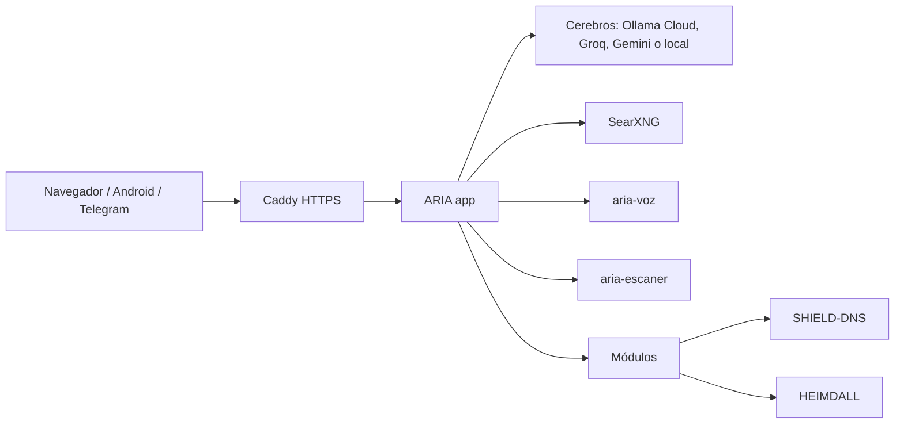
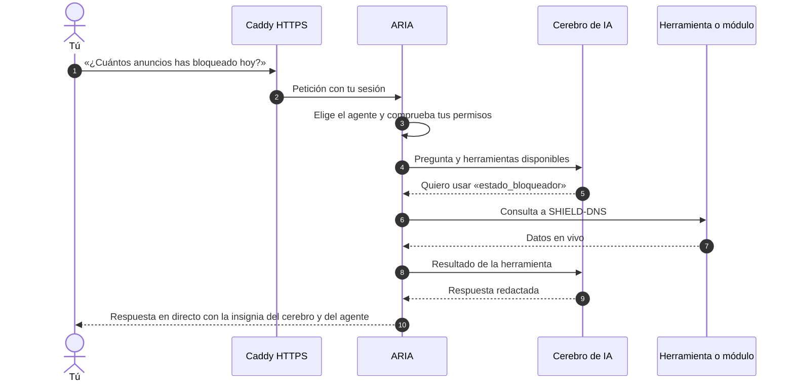
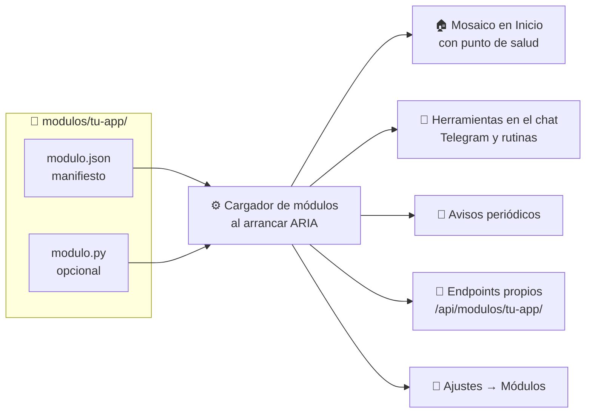

<a name="readme-top"></a>

<p align="center">
  <sub>Parte del ecosistema ARIA&nbsp;&nbsp;·&nbsp;&nbsp;<a href="https://github.com/BertMarti/ARIA">🤖 ARIA</a>&nbsp;&nbsp;·&nbsp;&nbsp;<a href="https://github.com/BertMarti/SHIELD-DNS">🛡️ SHIELD-DNS</a>&nbsp;&nbsp;·&nbsp;&nbsp;<a href="https://github.com/BertMarti/HEIMDALL">🔐 HEIMDALL</a></sub>
  <br>
  <a href="../README.md">🏠 README</a>&nbsp;&nbsp;·&nbsp;&nbsp;<a href="INSTALACION.md">📘 Instalación</a>&nbsp;&nbsp;·&nbsp;&nbsp;<a href="USO.md">🧭 Uso</a>&nbsp;&nbsp;·&nbsp;&nbsp;<a href="MODULOS.md">🧩 Módulos</a>
</p>

# ARIA: referencia técnica

Este documento reúne la información técnica que antes estaba en el README. La guía de instalación es la referencia para montar una instancia y la guía de uso explica el comportamiento visible.

## Arquitectura

ARIA es una aplicación FastAPI con frontend sin paso de compilación. Se ejecuta con Docker Compose y conserva sus datos en `data/`.



Componentes principales:

| Componente | Función | Puertos publicados |
|---|---|---|
| `aria-caddy` | HTTPS y proxy | 80, 443 |
| `aria-app` | Aplicación, chat, agentes y avisos | ninguno |
| `aria-ollama` | Modelo local y puente con Ollama Cloud | ninguno |
| `aria-searxng` | Búsqueda en internet | ninguno |
| `aria-voz` | Detección de «Aria», transcripción y voz local | ninguno |
| `aria-escaner` | Escaneo defensivo de la red | ninguno |
| `aria-descubre` | Descubrimiento local de televisores y altavoces | ninguno |

ARIA usa además `8095` solo en la red local para enviar contenido a una tele. SHIELD-DNS usa 53, 8080 y 8443; HEIMDALL usa 51820/udp y 51843.

## Requisitos

- Raspberry Pi 4/5 o PC/mini-PC con Linux, `arm64` o `amd64`.
- 4 GB de RAM como mínimo; 8 GB o más es lo recomendable.
- 16 GB libres como mínimo; 32 GB y SSD son preferibles.
- Raspberry Pi OS de 64 bits, Debian o Ubuntu.
- Docker con `docker compose` v2.
- Puertos 80 y 443 libres.

Windows no está probado. WSL2 puede servir para la parte web, pero no garantiza el acceso real a DNS, VPN y escaneo de la red.

## Instalación y actualización

Instalación de ARIA junto con las aplicaciones del ecosistema:

```bash
curl -fsSL https://raw.githubusercontent.com/BertMarti/ARIA/main/instalar-todo.sh | bash
```

Solo ARIA:

```bash
mkdir -p ~/homelab && cd ~/homelab
git clone https://github.com/BertMarti/ARIA.git
cd ARIA
./install.sh
```

Para actualizar:

```bash
cd ~/homelab/ARIA
./update.sh
```

Para ver el estado y los registros:

```bash
docker compose ps
```

Consulta [INSTALACION.md](INSTALACION.md) antes de configurar Cloudflare, copias, el DNS del router o el acceso VPN.

## Configuración

La configuración vive en `.env`, creado por `install.sh` a partir de `.env.example`. Los datos persistentes están en `data/`; ambos deben permanecer fuera del control de versiones.

Variables habituales:

| Área | Variables | Uso |
|---|---|---|
| Acceso | `ARIA_USER`, `ARIA_PASSWORD`, `ARIA_SECRET` | Usuario inicial, contraseña y firma de sesiones. |
| Red | `ARIA_LAN_IP`, `ARIA_HOSTS`, `ARIA_RED_PERMITIDA`, `ARIA_ROUTER_IP` | Direcciones y red autorizada para el escáner. Usa tus valores; `192.168.1.50` es solo un ejemplo. |
| Cerebros | `ARIA_CEREBROS`, `ARIA_MODEL`, `ARIA_NUM_CTX`, `OLLAMA_MEM_LIMIT` | Orden de proveedores y modelo local. |
| Proveedores | `GROQ_API_KEY`, `GEMINI_API_KEY` | Claves opcionales. No las publiques ni las registres. |
| Casa | `ARIA_CIUDAD`, `ARIA_PROVINCIA`, `ARIA_LUZ`, `ARIA_GASOLINERAS` | Tiempo, avisos, luz y gasolineras. |
| Integraciones | `SHIELD_URL`, `SHIELD_PASSWORD`, `VPN_URL`, `VPN_USER`, `VPN_PASSWORD` | Conexión con SHIELD-DNS y HEIMDALL. |
| Avisos | `TELEGRAM_BOT_TOKEN`, `VAPID_PUBLIC_KEY`, `VAPID_PRIVATE_KEY` | Telegram y notificaciones push. |
| Módulos | `ARIA_MODULOS`, `UPTIME_URLS` | Módulos activos y webs del módulo Uptime. |
| Acceso exterior | `ARIA_URL_PUBLICA`, `ARIA_CF_ACCESS_TEAM`, `ARIA_CF_ACCESS_AUD` | Dominio y SSO opcionales. |

La lista completa y comentada está en `.env.example`. Algunos ajustes, como el orden de los cerebros, se guardan desde la web y tienen prioridad sobre `.env`.

## Cerebros y datos que salen de casa

La cadena habitual es Ollama Cloud, Groq, Gemini y, como respaldo, Ollama local. El proveedor elegido puede recibir el mensaje, la memoria necesaria y los resultados de las herramientas. El cerebro local no requiere internet, pero puede ser más lento.

La palabra de activación se detecta localmente. Audio e imágenes se procesan en memoria y no se guardan. El modelo local no analiza imágenes. La ubicación, si se activa, se redondea y se elimina automáticamente.

## Desarrollo y pruebas

- Backend: `app/aria/`.
- Frontend estático: `app/static/`.
- Pruebas Python: `app/tests/`.
- Demo con datos inventados y capturas: `herramientas/demo/`.
- Módulos: `modulos/`.

Validaciones habituales:

```bash
node --check app/static/*.js
docker run --rm -v "$PWD/app:/srv" -w /srv python:3.12-slim sh -c "pip install -q -r requirements.txt pytest && python -m pytest -q"
node app/tests/md.test.js
```

No uses datos reales en demos, pruebas, capturas o documentación. Para una revisión completa, consulta `AGENTS.md`.

<p align="right"><a href="#readme-top">⬆️ Volver arriba</a></p>

## Qué pasa cuando le preguntas algo



## 🎙️ Cómo funciona la voz

| Paso | Qué se usa | Respaldo | Dónde ocurre |
|---|---|---|---|
| **Oír «Aria»** (manos libres) | Detector de palabra clave en `aria-voz` | — | Siempre en tu máquina: el sonido no sale de casa |
| **Entender lo que dices** | Whisper en **Groq** (gratis, muy rápido) | **faster-whisper** en `aria-voz` | Nube o tu máquina |
| **Hablar** | **Gemini TTS**: 14 voces femeninas, con tono y acento de España | **Piper** en `aria-voz` (voz femenina española) | Nube o tu máquina |
| **Lectura en streaming** | **Voz en streaming**: ARIA empieza a hablar en cuanto termina la primera frase mientras sigue escribiendo | — | El navegador, pidiendo el audio por partes |
| **Notas de voz de Telegram** | La misma voz, convertida a OGG/Opus en `aria-voz` | WAV | Tu máquina |
| **Escaparate y Ping** | Audio **pregrabado** (MP3) | Subtítulos | El navegador del visitante |

- **Cuota**: la capa gratuita de Gemini da pocas síntesis al día. Por eso las muestras de voces, las frases repetidas y el **briefing hablado** se guardan, y cuando la cuota se agota ARIA habla con Piper y avisa hasta qué hora.
- **Voz propia**: está aparcada. Las herramientas y el cuaderno de entrenamiento siguen en [`herramientas/voz-propia/`](herramientas/voz-propia/) para retomarla más adelante, siempre con el consentimiento de quien ponga la voz.
- **Privacidad**: el audio que grabas no se guarda nunca; solo se transcribe y se descarta.

## 🐳 Contenedores y puertos

| Contenedor | Para qué | Puertos en tu máquina |
|---|---|---|
| `aria-caddy` | HTTPS y proxy | 80 (redirige a 443), 443 |
| `aria-app` | La aplicación | ninguno |
| `aria-ollama` | Modelo local y puente con Ollama Cloud | ninguno |
| `aria-searxng` | Búsqueda en internet | ninguno |
| `aria-voz` | Voz local (Whisper, Piper, Vosk), sin salida a internet | ninguno |
| `aria-escaner` | Escaneo de red (nmap) | ninguno |
| `aria-descubre` | Descubrimiento de teles y altavoces por mDNS y SSDP/DLNA; usuario sin privilegios, sin capacidades y solo lectura | ninguno |

ARIA usa además el puerto `8095` para **Enviar a la tele**, solo en la red local. Las otras aplicaciones usan: SHIELD-DNS 53, 8080 y 8443; HEIMDALL 51820/udp y 51843. Si las instalas en la misma máquina no hay choques.

Comandos útiles (desde la carpeta de ARIA):

```bash
./update.sh                 # actualizar
./backup.sh                 # copia de .env y data/ en backups/ (guarda las 7 últimas)
./uninstall.sh              # quitar contenedores (conserva datos)
docker compose ps           # estado
docker compose logs -f app  # registros
```

## 🔌 Añade tus propias aplicaciones (módulos)

<p align="left"></p>

<p align="left"></p>

Un módulo es una carpeta en `modulos/`. ARIA lo carga al arrancar y lo enchufa en varios sitios a la vez:



El más sencillo solo necesita un `modulo.json` y ya pone un mosaico en Inicio con un punto verde o rojo según si tu aplicación responde:

```bash
cp -r modulos/_plantilla modulos/recetas
rm modulos/recetas/modulo.py modulos/recetas/compose.ejemplo.yml
```

`modulos/recetas/modulo.json`:

```json
{
  "id": "recetas",
  "nombre": "Recetas",
  "version": "1.0.0",
  "icono": "casa",
  "url": "http://{host}:8099/",
  "salud": {"tipo": "http", "host": "host.docker.internal", "puerto": 8099, "ruta": "/"},
  "roles": ["admin", "usuario"]
}
```

```bash
docker compose restart app
```

> ✅ **Comprobación:** en **Ajustes → Módulos** aparece «Recetas» y en Inicio, su mosaico.

Con un `modulo.py` puedes añadir además herramientas al chat («¿qué receta toca hoy?»), avisos periódicos y endpoints propios. Todo está explicado, con la referencia del SDK, en **[docs/MODULOS.md](MODULOS.md)**.

> [!WARNING]
> Un módulo con `modulo.py` es código que se ejecuta dentro de ARIA. Instala solo módulos que hayas leído o de fuentes de confianza.
